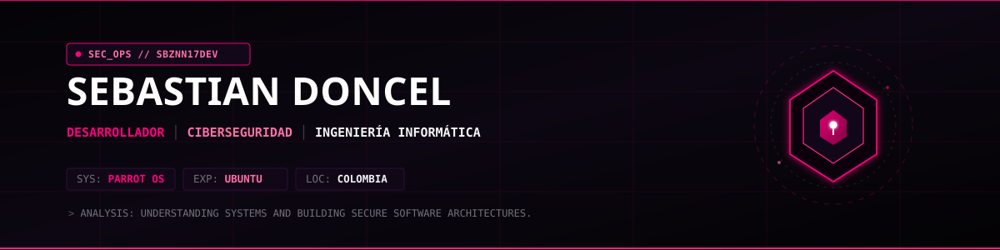
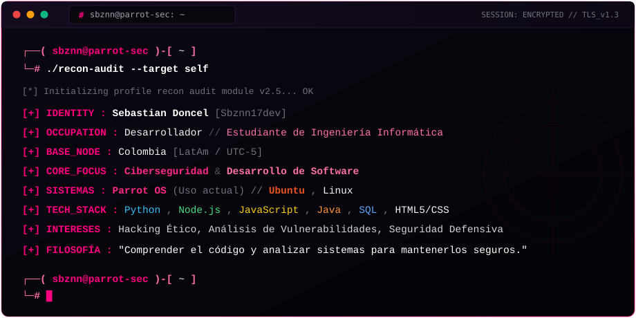

 

## `$ ./recon --target self`

## `$ cat tech-stack.yaml`

**Lenguajes de programación, backend & Bases de datos**

 

**Sistemas Operativos**

  
  &nbsp;&nbsp;
  
  &nbsp;&nbsp;
  

**Entornos & Control de versiones**

## `$ sysinfo --github-stats`

## `$ netstat --connections`

 

